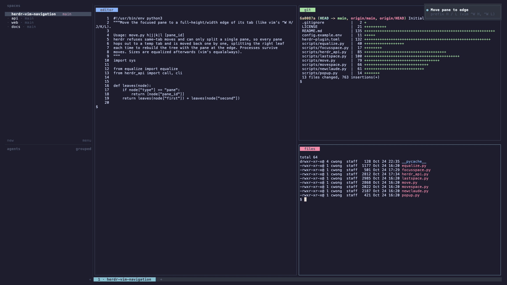

# herdr-vim-navigation

vim- and screen-style navigation for [herdr](https://herdr.dev): the window
commands your fingers already know, for herdr panes and spaces.



| Action | Does | Like |
|---|---|---|
| `move-left/down/up/right` | Move the focused pane to a full-height/width edge, any number of panes | vim `^W H/J/K/L` |
| `only` | Close every other pane in the focused tab | vim `^W o`, screen `^A q` |
| `only-tab` | Close every other tab in the focused space | vim `:tabonly` |
| `equalize` | Equal widths for panes side by side, equal heights for stacked ones | vim `^W =` |
| `last-space` | Jump back to the space you were in before; again to return | screen `^A ^A`, `cd -` |
| `space-up` / `space-down` | Move the focused space in the sidebar; keep pressing `^K/^J` in the popup | — |
| `space-first` / `space-last` | Focus the top / bottom space in the sidebar | vim `^W t` / `^W b` |

Not to be confused with [vim-herdr-navigation](https://github.com/paulbkim-dev/vim-herdr-navigation),
which makes `Ctrl+h/j/k/l` cross between Vim splits and herdr panes; the two
work side by side.

herdr has no built-in for any of these. Pane moves keep every process running:
panes are moved, never recreated.

## Requirements

- herdr ≥ 0.9.0, Linux or macOS
- `python3` (standard library only)

## Install

```sh
herdr plugin install cwong47/herdr-vim-navigation
herdr plugin action list --plugin herdr-vim-navigation
```

Update later with `herdr plugin update`.

To hack on it, link a local clone instead:

```sh
git clone https://github.com/cwong47/herdr-vim-navigation.git
herdr plugin link ./herdr-vim-navigation
```

## Key bindings

The plugin only provides actions; bind the ones you want in
`~/.config/herdr/config.toml`. A screen/vim-flavoured set:

```toml
[[keys.command]]
key = "prefix+="
type = "plugin_action"
command = "herdr-vim-navigation.equalize"

[[keys.command]]
key = "prefix+shift+q"
type = "plugin_action"
command = "herdr-vim-navigation.only"

[[keys.command]]
key = "prefix+ctrl+q"
type = "plugin_action"
command = "herdr-vim-navigation.only-tab"

[[keys.command]]
key = "prefix+shift+h"
type = "plugin_action"
command = "herdr-vim-navigation.move-left"

[[keys.command]]
key = "prefix+shift+j"
type = "plugin_action"
command = "herdr-vim-navigation.move-down"

[[keys.command]]
key = "prefix+shift+k"
type = "plugin_action"
command = "herdr-vim-navigation.move-up"

[[keys.command]]
key = "prefix+shift+l"
type = "plugin_action"
command = "herdr-vim-navigation.move-right"

[[keys.command]]
key = "prefix+b"
type = "plugin_action"
command = "herdr-vim-navigation.last-space"

[[keys.command]]
key = "prefix+ctrl+k"
type = "plugin_action"
command = "herdr-vim-navigation.space-up"

[[keys.command]]
key = "prefix+ctrl+j"
type = "plugin_action"
command = "herdr-vim-navigation.space-down"

[[keys.command]]
key = "prefix+{"
type = "plugin_action"
command = "herdr-vim-navigation.space-first"

[[keys.command]]
key = "prefix+}"
type = "plugin_action"
command = "herdr-vim-navigation.space-last"
```

`prefix+shift+h/j/k/l` replace nothing by default, and `prefix+=`/`prefix+b`
are unbound in herdr's defaults; check `prefix ?` against your own config.

## Notes

- **last-space** records focus changes with a background watcher, the plugin's
  startup hook. herdr doesn't stop startup hooks when its server stops, so each
  new watcher replaces the previous one; an orphaned watcher exits about a
  minute after its server is gone. State lives in `HERDR_PLUGIN_STATE_DIR`, one
  file per herdr session.
- **Pane moves** briefly hop panes through temporary tabs (herdr refuses
  same-tab moves and can only split one pane at a time), so the tab bar may
  flicker. Zoomed tabs are left alone.
- **Demo** is recorded with [VHS](https://github.com/charmbracelet/vhs) from
  [`demo/demo.tape`](demo/demo.tape) in a throwaway `demo` session; run
  `vhs demo/demo.tape` from the repo root, outside herdr.

## License

MIT
